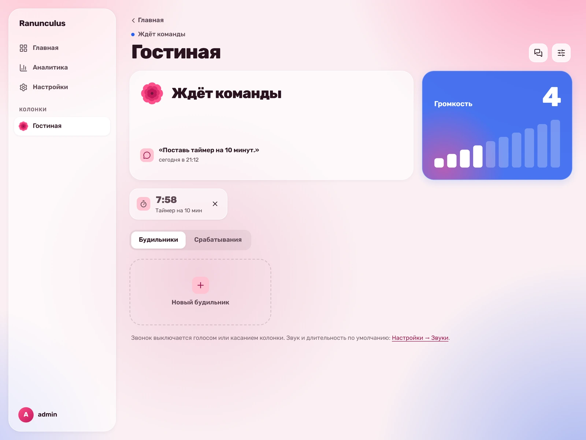
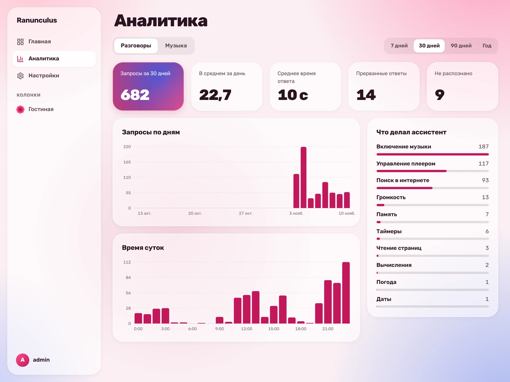
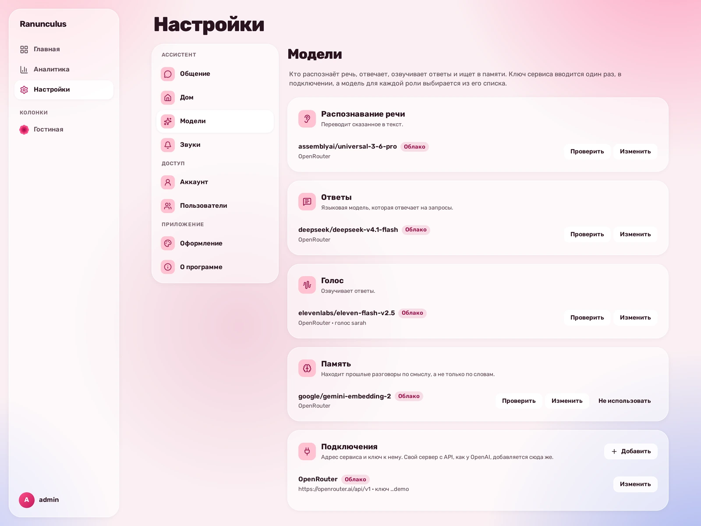

<h1 align="center">
  <picture>
    <source media="(prefers-color-scheme: dark)" srcset="https://github.com/ExceptionEight/ranunculus/raw/main/.github/assets/wordmark-dark.svg">
    
  </picture>
</h1>

<h3 align="center">Замена бэкенда Яндекс Станции 2 для вашего хоумлаба</h3>

<p align="center">
  <a href="https://github.com/ExceptionEight/ranunculus/actions/workflows/ci.yml"></a>
  <a href="https://github.com/ExceptionEight/ranunculus/releases/latest"></a>
  <a href="LICENSE"></a>
</p>

Ranunculus заменяет облачный бэкенд Яндекс Станции 2 вашим собственным сервером. На колонке с root-доступом вместо
Алисы работает небольшой клиент: он слушает слово активации «Мразота» (ну или можете обучить на свое любое и поменять системный промпт запросов) и передаёт звук на сервер. Распознавание речи,
голос, музыка, поиск, будильники и веб-интерфейс работают у вас дома в Docker. Модель для ответов можно взять любую:
облачную через OpenRouter или свою через Ollama или llama.cpp.

<p align="center">
  
</p>
<p align="center">
  
  
</p>

## Возможности

- Отвечает голосом, ищет в интернете и читает найденные страницы.
- Включает музыку с YouTube Music, ставит на паузу, переключает, перематывает.
- Ставит таймеры и будильники, говорит погоду, меняет громкость.
- Помнит прошлые разговоры и ведёт заметки о том, что вы о себе рассказали.
- Показывает на панели колонки, что делает: слушает, думает, ищет, говорит, играет музыку.
- Веб-интерфейс: колонки, история разговоров, будильники, звуки, статистика, настройки.

## Что нужно

- Яндекс Станция 2 (YNDX-00051) с root-доступом по SSH. Проверено на прошивке со сборкой 4778263334. Как получить
  root, описано в вики [hackalice.me](https://hackalice.me).
- Сервер с Docker Compose. Видеокарта не обязательна, но для качественных локальных синтезаторов речи очень не помешает.
- Модель с API, совместимым с OpenAI, и вызовом инструментов.

## Установка

1. Сервер:

   ```sh
   git clone https://github.com/ExceptionEight/ranunculus.git
   cd ranunculus
   docker compose up -d
   ```

   При первом запуске скачается около 0,5 ГБ моделей для распознавания и голоса.

2. Откройте `https://АДРЕС_СЕРВЕРА:52702`. Сертификат самоподписанный, поэтому браузер один раз предупредит. Создайте
   пользователя и добавьте модель в «Настройки → Модели».

3. Колонка:

   ```sh
   station/install.sh АДРЕС_КОЛОНКИ
   ```

   Скрипт заходит на колонку по SSH (порт 2222, root), ставит клиент в `/data/ranunculus`, отключает Алису и
   перезагружает колонку. В прошивке добавляется только один файл автозапуска. Вернуть Алису:
   `station/install.sh --uninstall АДРЕС_КОЛОНКИ`.

Скажите: «Мразота, привет».

## Обновление

```sh
git pull && docker compose pull && docker compose up -d
```

Колонки обновляются сами, когда подключаются к серверу.

## Настройка

Распознавание и голос заменяются в «Настройки → Модели» на любой сервис с API OpenAI:

| Вид | Что нужно от сервиса | Что входит в установку |
|---|---|---|
| Ответы | `POST /v1/chat/completions` с потоковой выдачей и вызовом инструментов | ничего: добавьте свою модель |
| Распознавание | `POST /v1/audio/transcriptions`: файл WAV, в ответе `{"text": "…"}` | GigaAM v3 |
| Голос | `POST /v1/audio/speech` с `response_format: "pcm"`: 16-битный моно PCM, частота в заголовке `X-Sample-Rate` (без него 24 кГц) | Silero |

- Модель на этом же сервере доступна по имени `host.docker.internal`, например `http://host.docker.internal:11434/v1`
  для Ollama. Она должна слушать не только `127.0.0.1`.
- Поиск по памяти по смыслу, а не по словам: `docker compose --profile memory up -d`. Нужно ещё около 3 ГБ памяти.
- Свой сертификат, обратный прокси и вход через OIDC задаются в `server.toml`. Ключи описаны в начале
  [`server/src/config.rs`](server/src/config.rs), файл монтируется в контейнер как `/app/server.toml`.

## Данные

Всё хранится в томе `ranunculus_data`: история и настройки, память, записи срабатываний слова активации, звуки, ключ и
сертификат. Наружу уходит только то, что вы подключили сами: запросы к облачной модели, поиск, YouTube и погода
Open-Meteo. Сказанное в журнал сервера не пишется.

## Что стоит знать

- Музыка идёт через неофициальный клиент YouTube (yt-dlp). YouTube может сломать его в любой момент, и правила сервиса
  такого использования не разрешают.
- Голоса Silero распространяются по лицензии CC BY-NC-SA 4.0: коммерческое использование запрещено.
- Сброс колонки кнопками вернёт заводскую прошивку, а она обновится и закроет root.

## Разработка

```sh
docker compose up -d --build        # образы из этой копии, а не опубликованные
cargo test --workspace              # нужен ffmpeg
cd web && npm ci && npm run lint && npm run build
```

Код оформляют `cargo fmt --all`, `ruff format services tools` и `npm run format` в `web/`. CI это проверяет.

## Лицензия

[MIT](LICENSE). Сторонние компоненты и их лицензии перечислены в [THIRD-PARTY.md](THIRD-PARTY.md).
